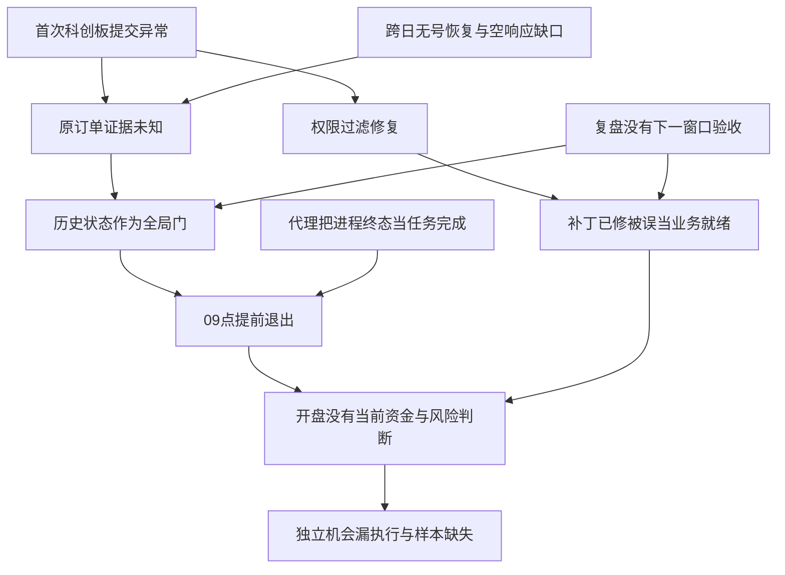

# 2026-10-30：开盘漏执行的系统性 5 Why

## 结论、责任与证据边界

本次主要失败是：系统把历史订单的证据状态扩散成全账户新买入前置条件，
代理又把这个程序终态当成业务结束，前一天的复盘没有要求证明次日运行连续性。
“科创板权限首次遇到”只解释最初触发，不能解释为什么修过权限后第二天继续停机。
这不是用户没有反复说明优先级；原契约 §1b 和 9 月的复核早已写过交易优先。

我承担本次执行与分析失误：09:01 过早收尾；把名义订单金额说成需要保护的资金，
没有先证明实际占用；用户催促后重复一个依赖未变的继续入口；核验当前现金和
当前可交易性太晚；首次复盘只解释直接触发，没有追到制度、产品和学习机制。

本次 APP 新计划、准备、委托、成交均为 0。原批次没有获得完整的当时可执行性
判断，不能记成正常无机会，也不能伪造成交或补回昨天。09:34 已越篮子只证明
那一刻不能追买，不能为 09:25 的漏执行开脱，更不证明当时一定可成交或损失多少。

下文“观察”来自原件，“推断”说明因果机制，“未知”保留缺证，“决定”来自本次
用户明确重申的业务目标。源码和原件快照/hash 固定在
[证据清单](/Users/xuanyue202/Documents/project/xiaocao/output/audit/opening-5why-20261030/baseline.json)。
分析基线 `172b8d0f2e2f040682b6dffa501ac9328978cac1`；实际晨间业务版本是 `f43dedbc`。

## 先把五种“处理完成”拆开

| 对象 | 已有事实 | 对今天应有的含义 |
|---|---|---|
| APP 科创板权限 | 用户已确认 primary 未开通；688/689 过滤及原排名补位已部署 | 已知账户能力限制，预期排除，通常不必再当成新事故 |
| 权限缺陷修复 | 补丁、回归、部署已记录 | 仅证明防止未来再次选入；还需自然采用验证 |
| 昨天原订单 | 本地仍缺唯一柜台号和终态；用户确认昨天问题已处理 | 记录人的处理结论及范围，保留原服务事实；不重复提交、不伪造拒单 |
| 今天经济影响 | 应以当前现金、持仓、潜在未结占用/敞口、风险约束判定 | 不能从旧 UNKNOWN 或原计划金额直接推出全局停买 |
| 次日就绪 | 昨日没有证明在保留旧状态时，今天的独立路径能走通 | 不能以“代码已修、下次验收”代替；这是此次遗漏的验收对象 |

因此，用户说“已经处理完成”与原始订单审计保留未知，可以在不同维度同时成立。
错误在于系统没有保存、消费这些分维度处置，把最保守的一个字段当成全部结论。
聊天记忆不是完全没读：本任务实际读了昨天记录；它反而再次强化了旧保护边界。
需要纠正的是可执行的处置模型和冲突规则，不是继续堆一段“以后注意”的记忆。

本次实际处置已保存为 [只读处置视图](/Users/xuanyue202/Documents/project/xiaocao/output/audit/opening-5why-20261030/incident-disposition.json)：
稳定根因类 `historical-state-global-execution-veto` 关联账户权限、原单和隔离能力。
它明确当前 owner、证据/hash、条件重开和下一验收；authority=0，不改原订单、
账本或生产交接，也不声称未来 owner 已接受移交或程序已自动消费这份视图。

## 原始时间链

| 北京时间 | 观察 | 能证明 / 不能证明 |
|---|---|---|
| 10-29 12:09 | 昨日修复记录：科创板过滤已部署，原单 UNKNOWN 保留 | 两项工作分开；没有证明今天新批次可运行 |
| 10-29 EOD | 日复盘明确保留旧 BUY、现金/费用未决，写下一晨间须精确核验 | 已知风险已记录；没有影响范围、原子恢复和盘前完成证明 |
| 10-30 09:00:00–17 | 原 runner 预检/旧单回读后 blocked；未进入冻结等待和当前分配 | 直接触发为全局旧单门，不能归因于今天候选或资金不足 |
| 09:00:18 | 合并受阻通知送达；09:01 代理结束本回合 | 通知可靠不等于业务恢复；原准备预算还剩绝大部分 |
| 09:25:50 | 原 producer 发布 17 行不可变批次 | 来源就绪；不是 APP 已执行 |
| 09:26:58–09:27:21 | 用户催促后的原回执一次继续，再次相同阻断 | 真运行入口，非真下单；依赖未修复，消耗唯一继续机会 |
| 09:31:31 | 同账户可用现金 76,395.98，持仓表无 688028 | 当前现金/持仓事实；不是完整风险放行、旧单终态或确定未冻结证明 |
| 09:32:43/48 | 精确 10-29 历史委托/成交日期已证、空表已证，但响应完整性未证 | 存在空结果确认缺口，不能加工成 absence proof |
| 09:34:15 | 001287 当前价 20.24，原篮子 19.92 | 当时不再能按原策略新买；不能倒推开盘没有机会 |
| 09:35:00 | 原绝对准备截止 | 不延预算、不链式继续、不重放已终态批次 |

原回执：[首次运行](/Users/xuanyue202/Documents/project/xiaocao/output/live/book_b_live_execution/runs/history/2026-10-30-62e1bc980edf.json)、
[原回执继续](/Users/xuanyue202/Documents/project/xiaocao/output/live/book_b_live_execution/runs/history/2026-10-30-6784fe2ac447.json)。
当前观察：[现金/持仓](/Users/xuanyue202/Documents/project/xiaocao/output/live/book_b_live_execution/operator/2026-10-30/current-buy-check.json)、
[权限后只读选择检查](/Users/xuanyue202/Documents/project/xiaocao/output/live/book_b_live_execution/operator/2026-10-30/permission-selection-check.json)、
[当前行情](/Users/xuanyue202/Documents/project/xiaocao/output/live/book_b_live_execution/operator/2026-10-30/001287-current-market.json)。
只读选择检查为 authority=0，不是本次实际 final-plan。

## 5 Why：不是一条直线，而是五条互相放大的因果链

### A. 已处理的科创板限制为何第二天仍导致停机

1. **为什么今天没有新买单？** 观察：晨间在 `_uncertain_execution_plan_ids`
   非空时抛全局错误，早于当前冻结、现金、风险与权限补位。
2. **为什么昨天权限已过滤，仍触发？** 观察：过滤未来候选与原订单状态是独立
   对象；没有把旧问题的“业务限制已规避”和“原单取证未终结”合成为今日处置。
3. **为什么原单审计能否终结决定整个新批次？** 观察：同一个 open-plan 集合被
   用作原单恢复/资金基数复用与新批次能否开始的总门，缺少当前经济影响接口。
4. **为什么没有把这种扩散当成缺陷？** 推断：设计优先保证“不误报已成交/已拒”，
   却没有同等验收“无关交易不被误杀”；正确的局部保守扩散成了过大的故障范围。
5. **为什么此前修过类似 SELL 问题仍复发？** 观察：9 月、10 月复核已反驳旧 SELL
   全局阻断；修复按订单方向局部处理，没有把“历史审计状态与当前执行分离”
   作为跨 BUY/SELL、跨日的共同不变量，并用次日场景检验。

反证：保留旧 claim，输入正确当前资金/敞口和独立候选，证明程序已有可采用的
有界隔离路径即可推翻“缺接口”；目前代码和本次两份回执没有提供这项证明。

### B. 为什么没有清楚的遗留处置与提前影响分析

1. **为什么晨间只能再读 UNKNOWN？** 观察：消费的是执行事件的服务状态，
   没有先消费一个涵盖限制、修复、经济影响、下一窗口动作的处置结论。
2. **为什么昨天的日复盘没有给出可操作结论？** 观察：已有“下一晨间须精确
   核验”，但没有绑定谁在何时读哪些事实、什么影响范围、哪条合法恢复入口。
3. **为什么“待核验”被接受为完成？** 观察：现有交接验证字段、引用、顺序、
   负责人和自然验收状态；不能自动证明“下一交易窗口仍能开始”。
4. **为什么记忆和修复报告不能补足？** 推断：它们是多维叙述，执行层只认某个
   单一状态；31k 字符晨间提示又重复边界，缺少一处明确的冲突与依赖判定规则。
   提示长度是风险放大因素，尚无对照实验能证明它是本次唯一原因。
5. **为什么记录机制只积累、不解决运行连续性？** 推断：缺少针对“旧问题如何
   被明日运行消费”的闭环验收；报告文件、已修补丁、形式完整被错当成能力恢复。

反证：找到昨日日交接中可直接采用、条件仍有效的有界资金/敞口处置，以及当前
入口对其实际消费的证据，才算机制已存在；不是再找到一段“交易优先”的文字。

### C. 为什么黄金五分钟没有成为实际最高优先级

1. **为什么 09:01 就收尾？** 观察：我把原进程 `blocked` 当成了整个任务完成。
2. **为什么没有先排障？** 观察：先重复“原单未知不能放行”，未立即读取当前
   可用、持仓及范围，未先检查可修复的恢复/取证能力。
3. **为什么早启动的余量没有转成恢复时间？** 推断：准备预算是进程预算，
   没有形成代理必须完成的“盘前影响处置/继续或明确不可修复”工作承诺。
4. **为什么用户催促后还是失败？** 观察：我在依赖或恢复能力未变化时消耗一次
   继续 claim；把运行命令当成行动，缺少“恢复前后改变了什么”的验证。
5. **为什么口头优先级压不过局部停止规则？** 推断：任务完成标准和冲突解决
   实际偏向“保存回执后结束”，而不是“在真实约束内尽最大努力恢复当前业务”。

反证：原任务若在 09:20 前已完成当前影响分析、最小恢复验证并保留可执行入口，
即使最终确因策略/资金拒绝，也应评价为不同结果。本次没有这些早期证据。

### D. 为什么严格取证变成不会收敛的重复查询

1. **为什么旧单始终唯一匹配不到？** 观察：无 order-id 的已 claim 单在
   `reconcile` 中先走 `recover`，后者调用当日 `_reconcile_rows`。
2. **为什么跨日还读当天表？** 观察：已映射原号的分支有历史路由，无号恢复
   仍依赖原提交前后的当日 order delta，没有对称的跨日路径。
3. **为什么精确历史空表也无法确认？** 观察：native `HistoryScope`
   的 `allPagesCaptured` 要求 `total > 0`；本次日期和空态都已证，完整性仍 false。
4. **为什么不能简单删掉 `total > 0`？** 观察：源码注释明确说未变化的空表无法
   证明异步日期刷新完成。缺的是本次查询完成的响应见证，不是把保守布尔值改绿。
5. **为什么这些缺口留到生产？** 推断：此前验收更重视歧义不误放行与理想接受
   路径，没有同时要求无号跨日/异步空响应的可收敛处置，以及无关新单继续能力。
   这不证明全部测试都没覆盖，但此次自然输入反例足以说明覆盖未达业务目标。

修复必须分别证明历史范围、响应完成、完整页、精确 tuple/claim、当前持仓和
合法状态机转移。相同现金、空持仓、零可见记录分别不足以单独伪造拒单/撤单。

### E. 为什么每日/每周复盘没纠正系统目标

1. **为什么昨日五问没有防住今天？** 观察：五问从结算阻断追到回执缺失、
   权限、测试不足，终点没有回到“明早独立新 BUY 是否可运行”。
2. **为什么诊断停在技术事实？** 推断：把“解释状态为何合理”当成复盘目标，
   未挑战这个状态是否应影响当前交易、影响范围是否过大。
3. **为什么早先 SELL 教训没有泛化？** 观察：稳定问题 ID 偏向日期/订单方向，
   缺少共因类关联；同一隔离失败以不同代码和事故名重新出现。
4. **为什么大量测试和丰富报告仍不能形成改进？** 推断：评价更容易统计文件、
   测试数和结算严格性，而恢复成功、误阻断率、漏执行和有效机会覆盖缺少共同分母。
5. **为什么这会伤害整个模拟的学习质量？** 推断：只在系统顺利时留下交易，
   失败日记作无动作/零收益会造成非随机缺失；策略表现、资金利用和风险结论
   可能只适用于“系统成功运行的子集”。此偏差大小尚未知，不能直接报 alpha 损失。

检验：以全部原冻结机会为分母重建阶段漏斗，区分策略拒绝、权限过滤、行情/风险
约束、工程漏执行和外部依赖；读回首次/最新事故与修复自然采用，而非数报告数量。

## 共同根因与故障树

这不是“风险控制越少越好”。正确方向是让保护边界与真实不确定性范围一致，
同时追求风险约束与业务可用性。昨日失败原因、历史审计未闭合和今天确实不能
下单分别取证；不能把任何一项当成其余两项。

## 多学科检查：同一事故对整个模拟意味着什么

| 视角 | 此次暴露的问题 | 必须取得的证据与验收 |
|---|---|---|
| 投资与组合 | 原 ACTIVE 中电港可按权限补位，但执行在选择之前停止；不能把最终没买说成没有候选 | 原冻结→资格→权限→资金整手→委托→成交各阶段漏斗；保留策略/篮子，观察漏在哪里 |
| 金融风险 | 未知名义本金被口头当成已占款；当前现金直到 09:31 才查 | 当前可用与已反映冻结、未反映的最大潜在占用/敞口分别界定；防漏算也防重复扣减；已证高点/暂停不重置 |
| 会计 | 最终 PnL/费用/结算状态被用于解释当前交易停止 | 执行可用资金/风险证明与最终账务分别完成；不能因利润 N/A 自动停止，也不能以可交易冒充平账 |
| 系统/IT | 故障范围从一个旧单扩散到整个新批次；缺有效降级和跨日恢复 | 状态与影响拆分、单写者、有限恢复、实际版本采用；失败输入必须有可收敛路线或精确不可恢复原因 |
| 算法/统计 | 系统故障可能选择性删除机会；paper/model 与 APP 的差异易被误归因策略 | 完整机会分母、缺失原因、时点/费用/成交证据；配对对照，缺失窗口不填零；参数改进仍走研究门 |
| 产品/人机 | 用户明确目标需要反复催促；“无需操作”被用作任务结束 | 自治恢复状态、真正用户操作项、业务/进程完成标准；通知送达与恢复成功分开 |
| 实验设计 | 把更多成交当成唯一经验，或把全部停止当成风险正确，都会失真 | 合法成交、有效无交易、工程失败分别留下观察；保护未验证的实验进入隔离研究，不回填正式账 |
| 代理治理 | 严格局部规则压过总体目标，重复执行替代排障，旧复盘免于挑战 | 冲突规则单一入口、行为证据审查、继续前依赖变化、反事实挑战、下一窗口责任与验收 |

对“能不能交易”的金融判断必须同时覆盖现金、当前 owned lots、潜在占用/敞口、
策略 NAV 和真实风险、账户/权限、原候选、当前行情及精确一次。76,395.98 元现金
本身不能认证全部条件；但未取这些证据前，也不能声称经济上已经不允许交易。
“创造条件”应落到提前取证、修复依赖和隔离范围，不能变成降低 COLD、追价或试造单。

## 对当前模拟的进一步检查：六个需要持续验证的系统问题

以下使用 [10-29 日复盘](/Users/xuanyue202/Documents/project/xiaocao/output/live/daily_execution_review_2026-10-29.md)
和 [本次 09:34 流水线观察](/Users/xuanyue202/Documents/project/xiaocao/output/audit/opening-5why-20261030/pipeline-observation.json)，
不冒称全历史审计或最新实时账户。
它们是与本次事故相连的检查结论/假设，不是自动晋级的策略改动。

1. **样本可能按系统容易执行的行情被筛选。** 09:34 观察中 Paper B 为
   `bought_source_blocked`：有 1 笔模型买入，688045 因
   `FIRST_MINUTE_HIGH_CHANGED_ACROSS_BOUNDARY` 缺证。首分钟保守 HIGH 是用户目的，
   应保留；累计极值跨边界变化也不自动证明采集器坏了。但这种证明方法可接受的
   子集可能与强势行情相关。应检验全部机会的接受/拒绝条件与行情路径是否相关，
   而不是只比较已买入子集收益或把没取证的窗口写成正常无买入。偏差方向/幅度未知。
2. **把执行时刻不同的模型当反事实，会误评交易算法。** 10-29 funded 记录是
   09:34 创建、使用之后的 09:35–09:39 窗口，不是 09:25 的 APP 订单。
   独立十万元、权限差异、未来窗口、1% 量上限、费用与未平仓风险均须分解。
   当天 control/no-KOL 等模型结果不能证明 APP 本可赚/亏多少，也不能评价 KOL alpha。
3. **知识多、模型调用多，不等于决策产出多。** 昨日日复盘报告 309 个候选、
   10 个已测、299 个未测，姿态 118 天陈旧；这些是该份报告时点的数值。
   同份反馈注明 execution verification 未做、profit attribution 未建立。
   要追踪“来源→有效条件→正式政策→实际采用→有效样本”的转化与弃用原因；
   过期支持应恢复、明确退役或降级，不能不断堆积再把知识数量当学习成果。
4. **关键路径应该按依赖价值安排预算。** 昨日 APP 已有 38 条提前准备，但冻结后
   最终派发只剩约 16.5 秒（[原收尾补充快照](/Users/xuanyue202/Documents/project/xiaocao/output/audit/opening-5why-20261030/supplemental-evidence/2026-10-29-closeout.json)
   的 `kol.final_dispatch_remaining_seconds=16.473`）；今日因 09:00 退出没有完整准备/采用路径。
   先保证能运行，再分析模型耗时、来源等待、主审与发布的真实预算；不能以换模型、
   降审核或增加并发掩盖 owner 提前结束。不同日期的就绪快慢不能单独归因于优化。
5. **会计严格性与可用性必须同时设计。** 昨日日复盘仍以 09-17 为最新可消费
   正式结算，现金/实际费用待核。已有批准的动态当日标记路径，缺历史结算并非
   自动停买理由；但估费收益、账务 NAV、当前可部署现金和单位风险 NAV 也不能混用。
   应分别衡量交易连续性和会计债务年龄，防止“永远 N/A”失去治理，也防止强行平账。
6. **复盘要识别自己可能维护错误目标。** 9 月报告曾把过度跨日栅栏当修复，后来被
   独立真实处置反驳；昨天已有五问仍没有解决今天的独立路径。周复盘应将此前
   “保护合理/已修”的结论作为可证伪对象。10-28 EOD 未进入首业务命令的原因仍缺
   平台证据，不能编成调度或网络故障；同时不能让“平台原因未知”抹去业务漏运行。

指标应采用可核对的机会分母：原冻结批次数、权限后合格批次、当时完成当前风险
判断的批次、按期收单、原单终态、有效无交易、工程漏执行、缺证与观察时延。
这些分母嵌套但含义不同，部分成交/部分缺证分别保留。策略比较进一步要求点时、
费用、资金规模和退出可比的独立样本；交易记录条数或每日 NAV 行数不能替代。
本轮没有计算缺证的收益、胜率或漏执行率，也没有运行新研究/业务来补这个报告。

## 处置机制与修复验收

采用原有每日 review 和 EOD→Weekly items，保留稳定 ID，并为根因类关联 BUY/SELL。
一项事故同时记录：业务限制、技术修复/部署、正式订单状态、当前经济影响、
下个合法窗口动作/owner、反证与验收。它是原证据的处置视图，不是新订单账本。

| 优先级 | 纠正工作 | 验收而非口号 | 本轮状态 |
|---|---|---|---|
| P0 | 明确当天执行与历史会计优先关系、原 owner 排障职责 | 契约 §1e、晨间/修复指引和现有任务一致；不允许早期可修复 blocked 自行收尾 | 本轮规范变更；运行实现另验 |
| P0 | 当前经济影响隔离替代旧状态全局门 | 保留旧 UNKNOWN/claim，资金和敞口边界正确时独立合法新单可达；边界不够/真实暂停仍拒绝；同代码约束保留 | 运行代码尚未修复 |
| P0 | 次日遗留处置在盘前可消费，继续入口能安全恢复 | 昨日记录→今日部署/保护门→09:20 前影响判定→09:24 复验；继续前依赖已变化、原预算不延长 | 规则已补；消费实现/自然采用待证 |
| P1 | 无号跨日路由与历史空结果响应绑定 | 原日期/claim/tuple 及完整响应可证；已拒/有成交/异步未完成/错日/分页/缺权限均区分，无提交重放 | 尚未修复，不能改绿空表 |
| P1 | 日/周复盘挑战旧结论并验收次日连续性 | 每条因果边有原件/推断/竞争解释/反证；下一窗口工作有实际 owner、入口和观察 | 本轮标准变更；自然效果待证 |
| P1 | 评价实验有效观察和工程漏执行 | 机会漏斗含全部失败/无动作；源时点、回执和账本分开，修复有自然采用 | 指标与采集实现待证 |

关键恢复场景应包括：旧 BUY/SELL 与新日不同代码、缺委托号、部分成交、冻结已/未
反映、边界不可界定、现金充足但敞口不足、真实暂停、未分类现金、缺原冻结、已越
篮子、同代码及重复 claim。测试必须体现行为反例，不锁死文案或版本号。
APP 工程测试遵守时段，真实必要故障恢复不被测试时段替代；禁止重放本日机会。

独立代码复核区分 Standards 与 Spec。规则、代码、受影响验证、部署、自然运行
为不同阶段；观察到自然通过前不写“问题闭环”。本轮工作是根因复盘、规范和
现有 Automation 指引修正；没有修改运行交易代码、订单/claim、资本和策略参数。
不能把这些规范变更称为已恢复新单执行能力。

## 日/周复盘的新完成标准

每日必须把“今天发生什么”延伸为“明天原入口在这些遗留状态下如何继续”。
周度至少交叉检查投资/组合、金融风险/会计、执行/系统、数据/统计、产品/代理和
实验效率，先解决执行确定性问题，再用原研究槽和 §10 判断策略改进。

对每个重大结论同时交代：原件、因果链、影响和未知、竞争解释、修复或实验、
owner、反证、下次合法验证窗口。发现跨日复发，首先质疑此前“已修”或“保护合理”
的结论；自然场景未覆盖不能以测试数代替。结构化字段只能保证记录完整，
不能自动保证模型的因果分析正确。

具体规范落在 [EOD→Weekly 交接](../EOD_WEEKLY_FEEDBACK.md)；
执行优先级的单一规则在 [Operating Contract §1e](../OPERATING_CONTRACT.md)。
旧报告和旧会计原件保留；本报告纠正其未覆盖的运行连续性判断，不改写历史事实。
